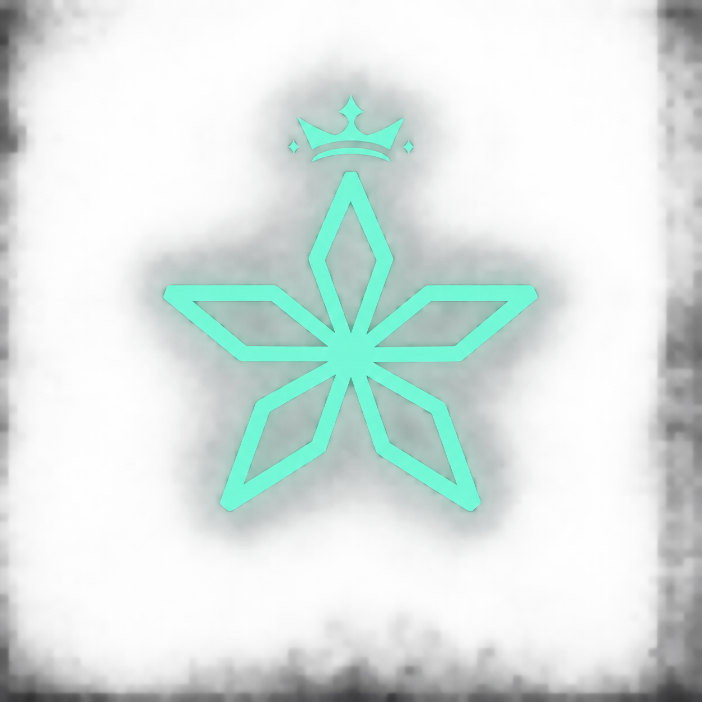

<p align="center"></p>
<h1 align="center">RazonHX</h1>
<p align="center">Redefine Your Desktop.</p>

A native macOS desktop customization environment built with **Swift 5, AppKit and a Rust core**. No SwiftUI, Electron, Tauri or embedded Chromium.

## Using the desktop

RazonBar, RazonDock, and the standalone clock start when you open the app. They complement the macOS menu bar, Dock, and desktop rather than replacing them. Imported wallpaper assignments and preferences are restored at launch.

- **Toolbar and Dock:** In either section, choose **On overlay** under Display to reveal the panel when the pointer approaches and hide it again when the pointer moves away. The two modes are independent. Adjust position, size, opacity, blur, and corner radius, or pin apps in Dock settings.
- **Clock & Date:** Choose the desktop corner, 12/24-hour time, and seconds. The standalone widget uses the reference’s monochrome analog dial, stacked digital date, and wide weather card. To show live weather, enter a display name and coordinates. Coordinates are only sent to Open-Meteo after opt-in, while the standalone clock is enabled.
- **Wallpaper:** Import or drop PNG, GIF, MP4, UTF-8 HTML, or WAV. Preview silently, apply to all displays or one display, and organize entries by category, favorites, and archive. Animated media can be paused; volume starts at zero. HTML supports self-contained CSS (including animations), not JavaScript, external assets, or multi-file projects. WAV uses live waveform data rather than a stock animation.
- **Launcher and windows:** Search installed applications from a toolbar/dock button, menu bar menu, or **⌘⇧L** while RazonHX is active. With Accessibility permission, arrange the last focused app’s window into a half, centered, or filled position.
- **Widgets, themes, and profiles:** Toggle a real CPU/memory/network/power widget, apply the **Obsidian Violet** preset for the violet reference styling, or create a custom palette in Appearance. Import/export themes and save, switch, or export desktop profiles. Profile JSON does not embed media files.

RazonHX stores settings in `~/Library/Application Support/RazonHX/config.json`. Older settings keep their existing values and gain desktop defaults. Corrupt settings are not silently overwritten. Restoring defaults backs up the configuration first; media files remain on disk. See the [roadmap](docs/ROADMAP.md) for outstanding work and [compatibility](docs/COMPATIBILITY.md) for real-Mac verification.

## Platform targets

| App target / scheme | CPU | Deployment target | Rust target |
| --- | --- | --- | --- |
| `RazonHX-Intel` | x86_64 | macOS **10.13** | `x86_64-apple-darwin` |
| `RazonHX-AppleSilicon` | arm64 | macOS **11.0** | `aarch64-apple-darwin` |

High Sierra does **not** support Apple Silicon. Intel High Sierra compatibility is an engineering target, pending real-machine testing. A modern CI pass and Mach-O minimum-version check are necessary, but insufficient. See [compatibility and verification](docs/COMPATIBILITY.md).

## Download builds (no local compilation required)

Open this repository's **Actions → Build RazonHX → a successful run → Artifacts**. Download the matching architecture artifact and unpack the outer Actions archive, then `RazonHX-Intel.zip` or `RazonHX-AppleSilicon.zip`. Move `RazonHX.app` to Applications.

Pushes (including `main`), pull requests and manual dispatches build both targets. Version tags (`v*`) additionally publish both zip files as GitHub release assets after all tests pass. This session does not create a version tag or release automatically.

### Unsigned development builds

CI builds are **unsigned and unnotarized**. Gatekeeper may prevent launch. Only if you trust and have verified the downloaded source/artifact, use Finder's **Open** context menu or the version-appropriate Security & Privacy / Privacy & Security approval. Newer macOS may require **Open Anyway**. Do not disable Gatekeeper globally. Distribution signing/notarization is not configured; never commit signing credentials.

## Build on a development Mac

Prerequisites: Xcode **16.4** with command line tools, Rust **1.85.1** via rustup. Rust is intentionally pinned: newer Rust releases raised their minimum supported macOS version. Do not upgrade blindly and lose High Sierra compatibility.

```sh
sudo xcode-select -s /Applications/Xcode_16.4.app/Contents/Developer
rustup toolchain install 1.85.1 --profile minimal --component rustfmt,clippy
rustup target add --toolchain 1.85.1 x86_64-apple-darwin aarch64-apple-darwin

# Choose ONE scheme; use AppleSilicon on an arm64 Mac.
xcodebuild -project RazonHX.xcodeproj -scheme RazonHX-Intel \
  -configuration Release -derivedDataPath build/Intel CODE_SIGNING_ALLOWED=NO build
```

The Xcode pre-build phase compiles the appropriate Rust static library. The `.app` is at `build/Intel/Build/Products/Release/RazonHX.app` (or the chosen derived-data directory). No user-specific paths, certificates or package managers are required by the Xcode project.

## Tests and verification

```sh
cargo test --locked --manifest-path razon-core/Cargo.toml
cargo clippy --locked --manifest-path razon-core/Cargo.toml --all-targets -- -D warnings

# On a native Intel Mac, after building:
RAZON_RUST_TARGET=x86_64-apple-darwin scripts/test-swift.sh
scripts/verify-bundle.sh build/Intel/Build/Products/Release/RazonHX.app x86_64 10.13
# On Apple Silicon use aarch64-apple-darwin, arm64, and 11.0.
```

Rust tests cover defaults, validation, corruption preservation, bounded input/events, atomic-write failure, persistence, reset and FFI ownership/null errors. Native Swift tests exercise the actual C/Rust bridge and color conversions. AppKit smoke tests construct the real settings window, navigate each working section, invoke General/Appearance control actions and verify persistence. They do not substitute for interactive UI testing.

`python3 scripts/generate-project.py` deterministically regenerates the committed Xcode project after adding Swift sources. It requires only Python's standard library. Shared schemes are checked in. Packaging verification checks resources, Info.plist, Mach-O architecture/minimum OS, and nonportable dynamic libraries.

## Repository layout

```text
RazonHX.xcodeproj/       Separate Intel and Apple Silicon targets, shared schemes
Sources/
  App/                  Native AppKit entry point and lifecycle
  Interface/            RazonSettings, RazonBar, RazonDock, RazonClock, RazonLauncher
  Modules/              Wallpaper, Themes, Widgets, Profiles, Window utilities
  Components/           Native reusable views and desktop panels
  Bridge/               RazonHXBridge.h and the owning Swift wrapper
razon-core/
  src/config/           Versioned schema, bundled defaults, validation
  src/engine/           State, transactions and settings lifecycle
  src/events/           Bounded internal notifications
  src/themes/           Shared color validation (not a full theme manager yet)
  src/system/           Bounded file reads and atomic writes
  src/ffi/              C ABI and panic/error containment
  src/modules/          Typed desktop preferences and wallpaper metadata validation
  src/wallpaper/        Reserved for phase-specific implementations
Resources/              Assets, icons, wallpaper/theme boundaries, official logo
Config/default.json     Single source for bundled defaults
Tests/                  SwiftTests and RustTests
.github/workflows/      Automated dual-architecture builds
scripts/                Build, test, verify, project generation
```

[Architecture](docs/ARCHITECTURE.md) · [Roadmap](docs/ROADMAP.md) · [Compatibility](docs/COMPATIBILITY.md) · [Original development brief](docs/MASTER_PROMPT.md)

MIT License. The project owner supplied the logo. The supplied Seelen UI image is a **design reference only**, not shipped in the application.
